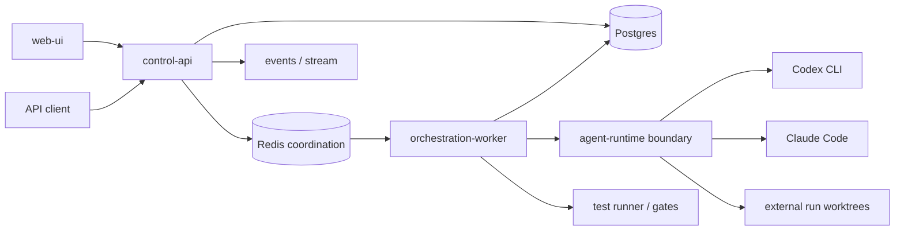
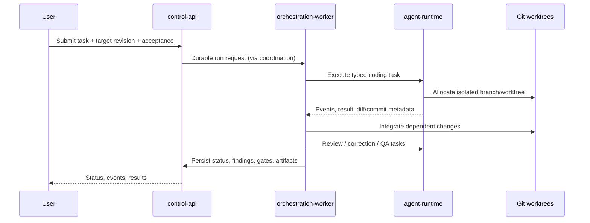

# Architecture and boundaries

Source: [SPEC §§4–7, 9–11, 13](../../SPEC.md). Everything below is **target design**, not deployed functionality.

| Logical service | Owns | Does not own |
|---|---|---|
| `control-api` | Authenticated intake, project/task/run/agent config, event query/stream | Long-lived CLI processes |
| `orchestration-worker` | CrewAI experiment, scheduling, states, integration, review/gates | CLI invocation implementation |
| `agent-runtime` | Workspace allocation, process lifecycle, provider adapters and structured output | Workflow policy |
| `web-ui` | Configuration and inspection | Server-side execution |
| `postgres` | Durable state, checkpoints and audit events | Temporary coordination |
| `redis` | Queue/coordination and transient state | Sole durable event store |
| Optional observability | Correlated traces/log views | Source-of-truth state |

The five named application/service repositories include the sample app benchmark target. Postgres, Redis and optional observability are infrastructure images, not custom source repositories. Service APIs and storage ownership need versioned contracts before implementation.

## Run data flow

Runtime worktrees live under `${FACTORY_WORKSPACE_ROOT}/runs/<run-id>/<task-id>/`, outside tracked submodules. This is Git isolation only. A sandbox and credential isolation policy remains [open](decisions/0001-repository-and-runtime.md).

## Execution modes

Mode A passes CLI tasks to CrewAI Agents through tools; Mode B uses a CrewAI Flow to call the runtime adapters; Mode C uses plain `asyncio`. All three must share fixtures, schemas, adapters, worktree manager, gates and metrics. CrewAI version, manager LLM/backend and possible API cost require verification rather than assumptions.
